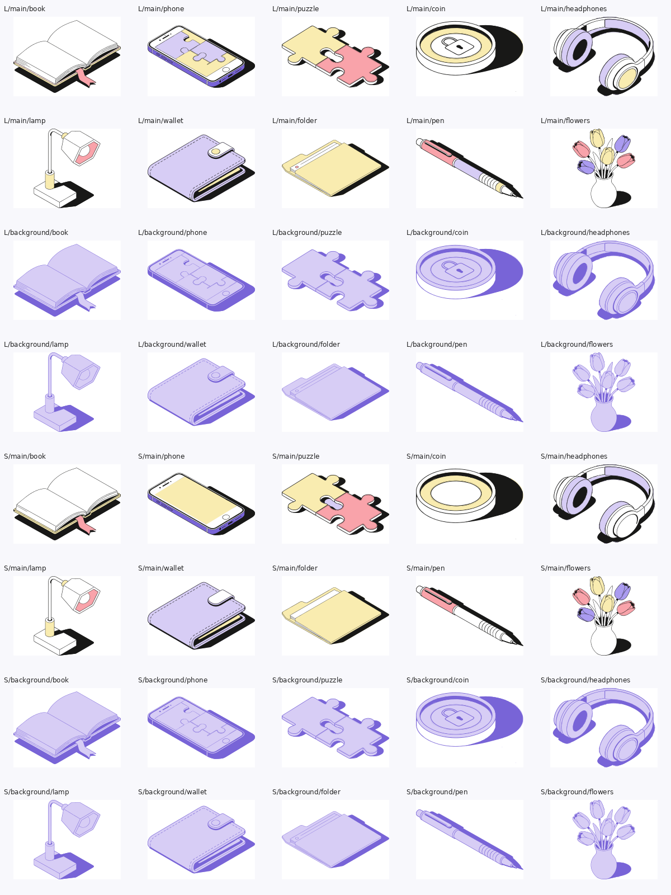
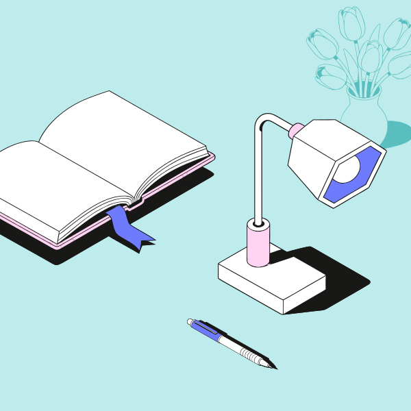
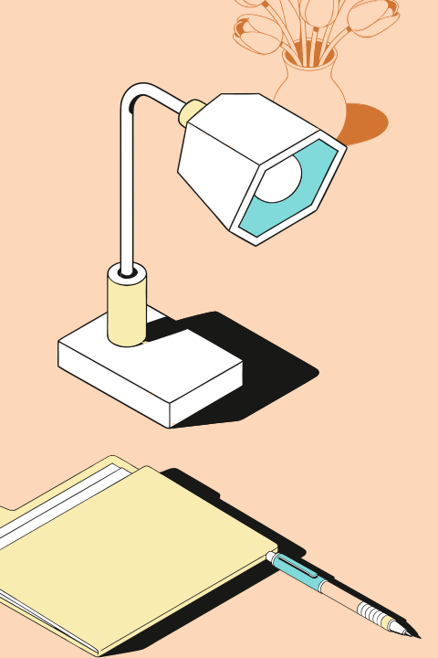

# Vector Composer

Figma-плагин для сборки редактируемых иллюстраций из готовых векторных компонентов. LLM подбирает существующие объекты по метафоре или списку названий, а плагин размещает их, применяет палитру и экспортирует SVG. Новые рисунки и SVG-пути с помощью AI не создаются.

В базовой библиотеке 10 объектов: книга, телефон, пазлы, монета, наушники, лампа, кошелёк, папка, ручка и цветы. Каждый имеет варианты детализации `L/S` и роли `main/background`: всего 40 вариантов. Доступны три палитры, импорт собственных SVG и палитр, три формата композиции и повторная компоновка с другим seed.



## Запуск проекта

Нужны Node.js с npm, Figma Desktop и доступ к выбранному LLM-провайдеру.

```bash
npm install
npm run build
```

1. В Figma Desktop выберите **Plugins → Development → Import plugin from manifest…** и откройте [manifest.json](manifest.json).
2. Запустите **Vector Composer AI — Test Task**. Плагин подключит базовую библиотеку; отсутствующие в документе исходные узлы импортирует из поставляемых SVG.
3. Для использования нативных исходников импортируйте в Figma файл `source/Тестовое _ иллюстрации (Copy).fig` и нажмите **Обновить** в плагине.
4. В **Settings** выберите Gemini, Groq, OpenRouter или собственный OpenAI-compatible endpoint, укажите модель и API-ключ. Ключ хранится только в памяти сеанса. Для собственного удалённого endpoint добавьте домен в `networkAccess.allowedDomains` в manifest и перезапустите плагин. Локальные LM Studio и Ollama предусмотрены через `localhost`.
5. В **Compose** выберите библиотеку, палитру, детализацию и формат. Введите метафору, например «Рост бизнеса», или список компонентов, например «книга, лампа, ручка», и нажмите **Создать композицию**.
6. Результат появится на странице `Vector Composer · Outputs`. Позиции, повороты и слои можно редактировать средствами Figma; кнопка **Скачать SVG** экспортирует композицию.

Каждая генерация требует успешного ответа выбранной LLM. При сетевой ошибке или некорректном ответе композиция не создаётся; локального fallback нет.

Во вкладке **Library** можно создать пользовательскую библиотеку из SVG или выделенных Figma-узлов. Варианты связываются общим semantic ID и атрибутами `L/S`, `main/background`. Во вкладке **Palettes** можно добавить цвета вручную или импортировать JSON и сопоставить исходные цвета со слотами палитры. Перекраска меняет только копии; фоновые объекты используют только фоновые цвета.

## Примеры композиций

Три примера собраны офлайн из предоставленных векторных элементов. SVG доступны для просмотра и редактирования; PNG используются только как превью.

| Композиция | Детализация, палитра и формат | Файлы |
|---|---|---|
| Рост бизнеса | L, лавандовая, горизонтальный | [SVG](examples/01-business-growth.svg) · [PNG](examples/01-business-growth.png) |
| Обучение и идеи | S, бирюзовая, квадратный | [SVG](examples/02-education-ideas.svg) · [PNG](examples/02-education-ideas.png) |
| Творческий процесс | L, персиковая, вертикальный | [SVG](examples/03-creativity-notes.svg) · [PNG](examples/03-creativity-notes.png) |





## AI-инструменты

- **Hermes Agent** с моделью `gpt-6-luna` через провайдер `openai-codex` — анализ требований и кода, доработка плагина, mock-тестов и документации.
- **Codex** — обновление документации.

Для подбора компонентов в плагине используется LLM. Работа с **Groq** успешно проверена.

Генераторы изображений для иллюстративной библиотеки не применялись: исходные векторы взяты из предоставленного `.fig`.

## Архитектура и исходники

[Описание архитектуры](ARCHITECTURE.md) объясняет хранение, извлечение и повторное использование SVG-элементов.

- `src/catalog.ts` — каталог объектов и исходных Figma ID.
- `src/engine.ts` — компоновка, масштаб и палитры.
- `src/llm.ts` — адаптеры провайдеров и проверка ответов.
- `src/plugin.ts` — библиотека, Figma API, хранение и экспорт.
- `ui.html` — интерфейс; `code.js` — собранный runtime.
- `assets/` — 40 SVG, метаданные, палитры и превью.
- `source/` — исходный `.fig`; `examples/` — три готовые композиции.
- `tools/` — офлайн-извлечение ассетов и проверки; `tests/` — автоматические проверки.

## Проверки

```bash
npm run typecheck
npm run check
python3 tools/qa_assets.py
python3 tests/test_qa_assets.py
```
